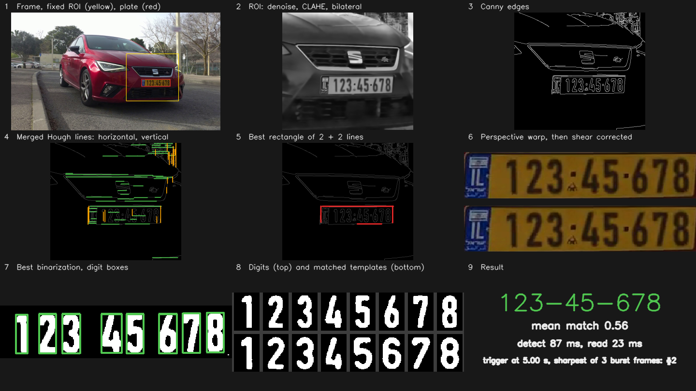
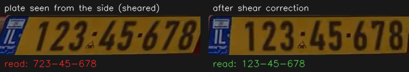

# Classical License Plate Reader

Reads Israeli license plates from a fixed camera at a kibbutz gate, with classical computer vision only —
no neural networks: a motion trigger picks the sharpest frame, Hough lines find the plate, and
hole-constrained template matching reads the digits.



<sub>Every step on the example clip. The plate number is fictional: it was replaced in every frame of the clip.</sub>

> **No real license plate numbers.** No real plate number appears in this repository, and none of the
> project's data is included. The [example clip](examples/gate_example.mp4) is real gate footage whose plate
> number was replaced by the fictional 123-45-678 in every frame; a road sign naming a nearby place and a
> parked car's plate are blurred.

## How it works

```text
video (fixed gate camera)
  -> motion trigger          background-subtracted motion in a thin strip at the trigger line,
                             against an adaptive baseline, 3 frames in a row
  -> burst, sharpest frame   the next ~0.1 s of frames; the highest variance of the Laplacian wins
  -> plate detection         in a fixed ROI: denoise, CLAHE, bilateral filter, Canny, Hough segments;
                             merge collinear segments, pair parallel ones, score every rectangle of
                             2 horizontal + 2 vertical lines (length, aspect, yellow on one side only)
  -> perspective warp        the 4 line intersections -> a 400x80 plate; shear correction
  -> binarization            inverse Otsu + black-hat at 5 thresholds; the candidate whose boxes look
                             most like a row of 7-8 digits (same top line and height) wins
  -> template matching       each digit vs 10 templates (0.7 NCC + 0.3 IoU), constrained by its holes
```

The digit templates are per-pixel medians of about 29,000 digit samples from 3,902 labeled plate crops
(`build_templates.py`). They are glyph shapes only and contain no plate number.

## Design decisions

- **A fixed camera, so a fixed ROI and trigger line, on purpose.** The gate camera never moves: the plate
  always passes the same region (55–80% of the width, 35–75% of the height), and a car always crosses the
  same line. Searching only there makes detection fast and removes most false candidates. Another camera
  needs these two settings changed (`ROI` in `plate_detection.py`, `TriggerCfg` in `trigger_burst.py`).
- **Hough lines over contours.** A plate's border is often broken by the bumper, glare or dirt, so its
  contour does not close. Hough segments survive gaps: collinear pieces are merged, parallel ones are
  paired, and every rectangle of two pairs is scored. Lines with yellow on one side only (the plate's
  border) count fully; lines inside the plate or in the background count less.
- **Several binarizations, one quality score.** No single threshold works by day and at night. Six
  candidates are scored on how much their boxes look like a plate's digits, and the best one is read.
- **The hole constraint.** Template matching confuses 0, 6, 8 and 9 under blur. The number of enclosed
  holes and their height decide which templates may match: two holes allow only 8 or 0, one high hole
  only 9, one low hole only 6.
- **Median templates.** The per-pixel median of thousands of segmented digits ignores the occasional bad
  segmentation that a mean would blur in.
- **Shear correction.** Plates seen from the side come out italic, and an italic 1 or 7 matches the 7 or 2
  template better. The plate is sheared back until its digit strokes are vertical (the shear with the
  sharpest column profile). On the development fold this alone took the reader from 43.9% to 51.7%;
  with the yellow-region warp for loose crops, to 56.4%.



## Results

A plate counts only if every digit is right.

| Test | Result |
|---|---|
| Gate clips, full pipeline (6 clips at 120 fps, 4 vehicles, day and night; the development clips) | 6 / 6 |
| Gate clips at 30 fps, full pipeline (the 4 day clips at a quarter of the frame rate, 4 other night recordings) | 5 / 8 |
| 40 plates photographed in the street and cropped by hand, leave-one-out | 39 / 40 (97.5%) |
| Street video crops, held-out drive (424 crops of 217 plates) | 242 / 424 (57.1%) |
| Street video crops, 5-fold cross-validation by plate (5,070 crops) | 2,963 / 5,070 (58.4%) |

- **Leave-one-out** means the plate's own number never reaches the templates it is read with. With
  templates built only from those 40 plates, the reader scored 38/40 on the same plates (in-sample) but
  35/40 leave-one-out; templates from the larger set raised leave-one-out to 39/40.
- **Street crops** are plates cut from driving videos through Israeli cities, at least 90 px wide, every
  number checked by hand; plates whose number was not certain were left out. 5,070 crops of 2,698 plates
  from ten drives serve for templates and cross-validation (all crops of a plate in one fold); 424 crops
  of 217 plates from an eleventh drive, in a city none of the others visits, are held out for testing.
- **Errors.** About a quarter of the held-out crops (110 of 424) segment into the wrong number of
  digits; on the rest, 94.0% of digits are right. Most confusions are 6→5, 8→0 and 1→0 on the held-out
  drive, and 7→2, 8→0 and 7→3 in cross-validation.
- **Small crops.** On the held-out drive the reader gets 37.6% of crops 90–119 px wide (about 24 px
  high), 66.4% of crops 120–199 px wide and 76.3% of wider ones.
- **Tuning.** The few free choices (crop alignment, shear range) were made on cross-validation fold 0
  only; no choice was made on the held-out drive.
- **Gate clips at 30 fps.** In one day clip the detector picks a wrong rectangle on the chosen frame. Two
  failures are dark cars at night: in one no plate rectangle is found; the other barely changes the trigger
  strip (motion peaks at 60% of the threshold), so the trigger never fires.

### Speed

On a desktop CPU (Intel, 20 threads), per 1080p frame: the trigger takes 0.7 ms (decoding the example
clip, 3 ms). After the trigger: sharpness 13 ms per burst frame, plate detection 91 ms, reading 11 ms.

## Limitations

- **Israeli civilian plates only:** 7 or 8 digits, no letters, one row, with the blue strip on the left or
  at the bottom.
- **One fixed camera.** The ROI and the trigger line belong to the camera's placement. One trigger is
  handled per run.
- **Small and tilted crops.** Away from the gate camera, small and strongly tilted plates are where the
  reader fails: a quarter of the street crops split into the wrong number of digits, and on crops under
  120 px wide it reads about a third of the plates.
- **Night.** A dark car can cross the trigger line without enough contrast to fire it, and headlight
  glare can break the plate's border lines.

## Running it

Python 3.12. From the repository folder:

```bat
python -m venv .venv
.venv\Scripts\python -m pip install -r requirements.txt
.venv\Scripts\python main.py
```

On Linux or macOS use `.venv/bin/python`. `main.py` plays the example clip with the red trigger line until
the car crosses it, then shows every step of the pipeline in one window (any key closes it).

```bat
.venv\Scripts\python main.py path\to\gate_video.mp4    REM your own clip (the camera must match the ROI)
.venv\Scripts\python main.py path\to\frame.png         REM a single frame
.venv\Scripts\python main.py --save out                REM no windows: writes out\pipeline.png
```

**Data is not included** (it contains real plates). `build_templates.py` and `evaluate.py` expect it in
`data/`, with every plate image named by its number:

```text
data/
  reader/plates/**/12345678.png             training crops: the number, optionally followed by _anything
  reader/test/<set>/**/1234567_x.png        held-out test crops, one folder per test set
  street_plates/12345678.jpg                hand-cropped plates (leave-one-out test)
  gate/videos/, gate/videos_30fps/, gate/pictures/
  gate/labels.json                          {"videos": {"<clip name>": "12345678"}, "pictures": {...}}
```

```bat
.venv\Scripts\python build_templates.py     REM data/reader/plates -> templates/
.venv\Scripts\python evaluate.py            REM every test set found under data/ (or --data DIR)
```

## Repository layout

```text
main.py                 the demo: trigger, detection, reading, the figure of every step
trigger_burst.py        motion trigger and the sharpest frame of a burst
plate_detection.py      Hough-line plate detector and perspective warp
digits_recognition.py   alignment, binarization, digit boxes, hole-constrained template matching
build_templates.py      the digit templates from labeled plates
evaluate.py             whole-plate accuracy on every test set
templates/              the 10 digit templates
examples/               the example clip (fictional plate number)
docs/                   the figures of this README
pyproject.toml          lint settings (Ruff)
```

## Context

A solo final project for the Digital Image Processing course at Azrieli College, 2026.

## License

[MIT](LICENSE)
